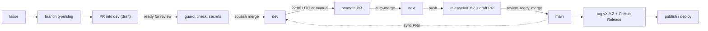

# Lifecycle: from issue to release

What fires when. Rules are in [`BRANCH-AND-RELEASE-POLICY.md`](./BRANCH-AND-RELEASE-POLICY.md); setup and
troubleshooting are in [`WORKFLOW.md`](./WORKFLOW.md). Every step is a `make` target, so you can run it locally.

## Stages

| #   | Trigger                                           | Workflow / target                   | What it does                                                                                      |
| --- | ------------------------------------------------- | ----------------------------------- | ------------------------------------------------------------------------------------------------- |
| 1   | PR opened, edited, pushed (draft or not)          | `pr.yml` `guard` (`make pr-guard`)  | Validates base, branch name and Conventional Commit title                                         |
| 2   | PR marked ready for review                        | `pr.yml` `hygiene`, `test`, `check` | pre-commit hooks on all files, then `make ci` on the detected runners; `check` rolls them up      |
| 3   | any PR                                            | `secret-scan.yml`                   | gitleaks over the PR's commit range                                                               |
| 4   | PR (ready) into `next`/`main`, or label `run-e2e` | `pr.yml` `e2e` (`make e2e`)         | End-to-end suite; adding the label starts it                                                      |
| 5   | PR (ready) into `main`                            | `pr.yml` `package` (`make pack`)    | Builds the release artifacts as a dry run                                                         |
| 6   | PR ready                                          | `pr.yml` `review`                   | Optional AI review (needs `CLAUDE_CODE_OAUTH_TOKEN`)                                              |
| 7   | PR and push to `dev`, weekly                      | `security.yml`                      | Dependency review + CodeQL for the detected languages                                             |
| 8   | PR squash-merged into `dev`                       | (branch deletes itself)             | Feature lands; nothing is versioned yet                                                           |
| 9   | 22:00 UTC daily or manual                         | `promote.yml` (`make promote-pr`)   | Computes bump + version from commits, opens/refreshes `dev -> next`, auto-merges when checks pass |
| 10  | push to `next`                                    | `next.yml` (`make cut-release`)     | Cuts/refreshes `release/vX.Y.Z`: versions, lockfiles, `CHANGELOG.md`; optional preview deploy     |
| 11  | push to `release/v*`                              | `pr-merged.yml` (`make release-pr`) | Opens/refreshes the **draft** PR into `main` with the changelog section                           |
| 12  | push to `next`/`release/v*`, nightly              | `matrix.yml`                        | `make ci` + `make e2e` on every configured OS                                                     |
| 13  | release PR merged into `main`                     | `release.yml` (`make tag-release`)  | Tags `vX.Y.Z`, publishes the GitHub Release, deletes the release branch                           |
| 14  | after stage 13                                    | `release.yml` `wrapup`              | Opens sync PRs `main -> next` and `main -> dev`; prunes merged branches                           |
| 15  | `vX.Y.Z` tag pushed                               | `publish.yml`                       | Builds artifacts, attaches them to the Release, optional PyPI / npm / crates / EAS / deploy       |
| 16  | Dependabot PR                                     | `automerge.yml`                     | Enables squash auto-merge once checks pass                                                        |
| 17  | daily                                             | `stale.yml`                         | Labels idle issues and PRs, closes them after a grace period                                      |

Drafts only run stage 1. The first release PR into `main` is created as a draft; mark it ready when you want
checks and `package`/`e2e` to run, then merge it with a merge commit.

## Issues and labels

1. Triage an issue: one `type:*` and one `priority:*` label, `status:todo`. Add a `stack:*` label.
2. Start work: `status:in-progress`, branch `<type>/<n>-<slug>` (for example `gh issue develop 123`).
3. Open a PR into `dev` with `Closes #123` in the body. `dev` is the default branch, so the issue closes when
   the PR merges.
4. `release`, `breaking-change`, `run-e2e`, `dependencies`, `security` are automation or release markers.

Labels and repository options are defined in `.github/settings.yml` (`make labels`, `make settings-apply`).

## Notes

- `promote.yml`, `next.yml`, `pr-merged.yml` and the `wrapup` job of `release.yml` run as the automation GitHub
  App. Events from `GITHUB_TOKEN` do not start workflows, so without the App the required checks on those PRs
  would never run.
- `main` is never pushed to directly: it only moves through the release PR.
- `matrix.yml` and `promote.yml` schedules run from the default branch (`dev`).
- Everything optional is opt-in by repository variable (`PUBLISH_*`, `DEPLOY_COMMAND`, `PREVIEW_DEPLOY_COMMAND`,
  `CODEQL`, `DEPENDENCY_REVIEW`); a fresh template builds and publishes nothing.
